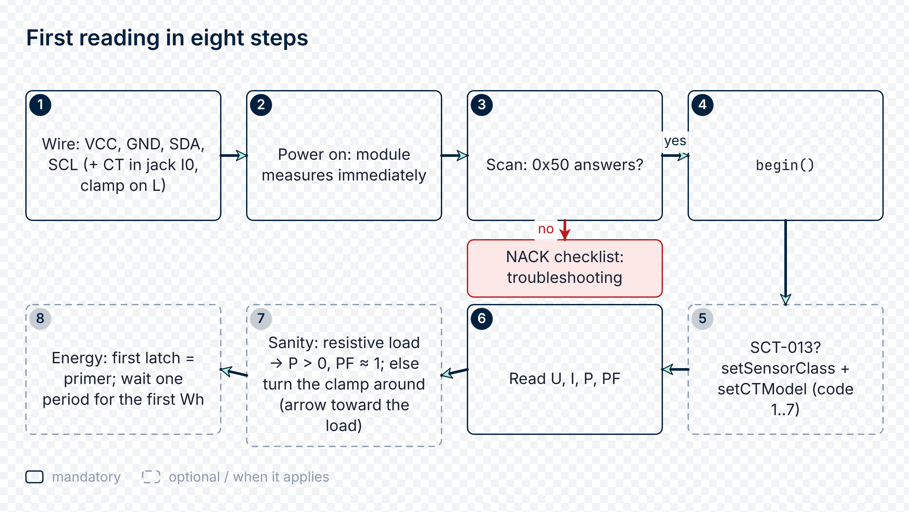

# 05 · Quickstart

A five-minute hello-world: install the package, wire up the module,
select a sensor, and read your first RT value and your first per-period
snapshot (Wh). This tutorial covers both runtimes in parallel —
**MicroPython** (on ESP32 / RP2040 / STM32 / Pyboard) and **CPython**
(on Raspberry Pi / Orange Pi / Rock Pi / x86 + USB-I²C).

For the details (pinout for a specific host, multi-module bus,
choosing an SCT-013 by range), see the neighboring chapters:

- [04 · Wiring](04_hardware.md) — hardware details and
  per-host pin tables
- [03 · Current sensor selection](03_sensor_selection.md) — which SCT-013
  model to use and why

## What you'll need

> ⚠ **Mains safety.** Mains voltage can kill. Disconnect and lock out the
> circuit before connecting the L/N terminals or fitting the clamp; have a
> qualified person do mains wiring and any work inside a panel. Clamp **one**
> conductor only (L) — never the whole cable (clamping L and N reads ~0). The
> clamp itself is contactless.


- An rbAmp module (any module line, UI1 for simplicity)
- One of these hosts:
  - **CPython**: Raspberry Pi (any model) / Orange Pi 5 / Rock Pi 5
    / x86 + USB-I²C dongle
  - **MicroPython**: ESP32 (DevKitC / S2 / S3 / C3) / RP2040 (Pico /
    Pico W) / STM32 (Pyboard / Nucleo)
- An SCT-013 CT clamp rated for your maximum current (5A / 10A / 30A / 50A / 100A)
- A 5 V supply to power the module (from the host's USB-5V or external)
- An AC circuit to measure (a lamp, kettle, or household appliance)

## Which path do I follow?

Check `dev.is_std` (or the SKU label on the module — see
[02 · Module lines](02_tiers.md)). **STD module:** skip Steps 4-5 and go to
[06 · Examples](06_examples.md), Scenario 11. **BASIC module:** follow all steps.
Step 3 and Step 4 are the same for both.



## Step 1 — Installing the package

### CPython (on a Linux SBC or x86)

```sh
pip install rbamp
```

(On a Debian/Ubuntu system you can use the system `smbus2`
alternative `sudo apt install python3-smbus`, but the `smbus2`
from pip is recommended — it supports the `with SMBus(...)` context manager.)

Verify:

```sh
rbamp --version          # rbamp 1.6.0
rbamp --bus 1 scan       # I²C scan, should show 0x50
```

### MicroPython (on ESP32 and others)

```sh
mpremote mip install github:rb-amp/rbamp-python
```

Or copy the package manually:

```sh
mpremote cp -r path/to/rbamp/ :rbamp/
```

The package installs to `/lib/rbamp/` on the device.

## Step 2 — Wiring

Four wires plus optional DRDY:

| rbAmp pin | Host |
|---|---|
| `VCC` | +5 V (range 4.5..5.5 V) |
| `GND` | GND |
| `SDA` | I²C SDA (RPi pin 3, ESP32 GPIO21, RP2040 GPIO0/etc.) |
| `SCL` | I²C SCL (RPi pin 5, ESP32 GPIO22, RP2040 GPIO1/etc.) |

Power **must be 5 V**. The I²C lines run on 3.3 V logic but are
5 V tolerant. The module board already has built-in 4.7 kΩ pull-up
resistors — for a single module no external ones are needed.

The full pinout table for each host is in
[04 · Wiring](04_hardware.md).

The SCT-013 CT clamp snaps around the **line conductor (L) only**, with
the arrow on the clamp body pointing **in the direction of current
toward the load**. See more in [04 · Wiring](04_hardware.md).


> ⚠ **Mains safety.** Mains voltage can kill. Disconnect and lock out the
> circuit before connecting the L/N terminals or fitting the clamp; have a
> qualified person do mains wiring and any work inside a panel. Clamp **one**
> conductor only (L) — never the whole cable (clamping L and N reads ~0). The
> clamp itself is contactless.


## Step 3 — First script (RT read)

A minimal script: tell the module which clamp you use (once), then read
U / I / P / PF. Model codes are listed in Step 4; `3` below is SCT-013-030.
The module line / variant table is in [02 · Module lines](02_tiers.md).

### CPython version

```python
import time
from smbus2 import SMBus
from rbamp import RbAmp, RbAmpError, RbAmpSensorClass

with SMBus(1) as bus:
    with RbAmp(bus, 0x50) as dev:
        # the context manager's __enter__ automatically calls dev.begin()
        # the module variant is detected automatically
        variant = dev.read_variant()
        label = dev.read_label() or "(unset)"
        print(f"Module ready: variant={variant}  label={label!r}")
        # variant codes: see the table in 02 · Module lines
        # Once per installation (saved in the module's flash):
        dev.set_sensor_class(RbAmpSensorClass.SCT_013)
        dev.set_ct_model(3)   # SCT-013-030, see Step 4
        while True:
            try:
                print(f"U={dev.voltage:.1f}V  "
                      f"I={dev.read_current(0):.3f}A  "
                      f"P={dev.read_power(0):.1f}W  "
                      f"PF={dev.read_power_factor(0):.3f}")
            except RbAmpError as e:
                print("read failed:", e)
            time.sleep(1)
```

Run:

```sh
python quick_read.py
```

### MicroPython version

```python
import time
from machine import I2C, Pin
from rbamp import RbAmp, RbAmpError, RbAmpSensorClass

i2c = I2C(0, scl=Pin(22), sda=Pin(21), freq=50_000)   # ESP32 default
with RbAmp(i2c, 0x50) as dev:
    dev.set_sensor_class(RbAmpSensorClass.SCT_013)   # once per installation
    dev.set_ct_model(3)                              # SCT-013-030, see Step 4
    print("Module ready.")
    while True:
        try:
            print("U={:.1f}V  I={:.3f}A  P={:.1f}W  PF={:.3f}".format(
                dev.voltage, dev.read_current(0),
                dev.read_power(0), dev.read_power_factor(0)))
        except RbAmpError as e:
            print("read failed:", e)
        time.sleep(1)
```

(On MicroPython, `.format()` is used instead of f-strings — for
performance and compatibility with older ports; on newer ports
f-strings work too.)

Run:

```sh
mpremote run quick_read.py
```

Expected output with a load switched on (values depend on your load):

```text
Module ready.
U=230.4V  I=0.523A  P=119.8W  PF=0.987
```

> `U` shows roughly the mains voltage (220-240 V for 230 V
> networks). With no load, `I` is ~0 and `PF` is undefined (it may print
> `nan`, `0`, or a placeholder) — the exact form doesn't matter while the
> current is zero. If `I` stays at 0.000 A with the load on, check the
> clamp (one conductor, correct direction) and the model code, then see
> [10 · Troubleshooting](10_troubleshooting.md).

## Step 4 — Current sensor configuration

You **must** tell the module the sensor class and model (done in
Step 3's script). Without this, the calibration coefficients are not
loaded and the current readings stay at zero. Always call
`set_sensor_class()` first, then `set_ct_model(code)`.

Choose the code that matches your clamp:

| `code` | Model | Range | Typical use |
|:---:|---|---|---|
| 1 | SCT-013-005 | 0..5 A | Small loads, a single outlet |
| 2 | SCT-013-010 | 0..10 A | Refrigerator, washing machine |
| 3 | SCT-013-030 | 0..30 A | Household feed up to ~7 kW |
| 4 | SCT-013-050 | 0..50 A | EV charger, electric heating |
| 6 | SCT-013-020 | 0..20 A | Medium feed, 3–4 kW appliances |

More on selection — [03 · Current sensor selection](03_sensor_selection.md).

> These two calls are made **once** at first installation — the
> choice is saved to the module's flash and survives a reset. The
> total time is about **1.4 seconds** (two flash writes × ~700 ms each).
>
> On subsequent runs of the script you don't need to call
> `set_sensor_class()` and `set_ct_model()` (the module remembers).
> Calling them again with the value the module already holds is a no-op.

## Step 5 — Energy accounting (Wh)

The module returns only instantaneous quantities plus the average
power over a period. **The Wh themselves are computed by the package**
using the master clock (`time.monotonic()` on CPython,
`time.ticks_ms()` on MicroPython):

```text
E_Wh += avg_P × master_dt_s / 3600
        [W]    [seconds]      →  [Wh]
```

where `master_dt_s` is the seconds between two successful calls to
`dev.read_period_snapshot()`.

> **Wait one full period before the first `read_period_snapshot()`.**
> `begin()` already starts a period, so a snapshot taken right after it
> covers only a fraction of a second and Wh will read ~0. The loops below
> sleep 60 s first for this reason.
>
> **The Wh counter is kept in memory.** It restarts from 0 after a script
> restart or reboot. For an absolute total, store `dev.energy.wh(0)`
> yourself. On BASIC modules export is not counted (see
> [02 · Module lines](02_tiers.md)). On an STD module use
> `read_std_energy()` instead (Scenario 11 in
> [06 · Examples](06_examples.md)).

A minimal periodic-accounting template (once a minute):

### CPython version (period meter)

```python
import time
from smbus2 import SMBus
from rbamp import RbAmp, RbAmpSensorClass, RbAmpStaleError, RbAmpError

with SMBus(1) as bus, RbAmp(bus, 0x50) as dev:
    dev.set_sensor_class(RbAmpSensorClass.SCT_013)
    dev.set_ct_model(3)   # SCT-013-030

    while True:
        time.sleep(60)   # 60-second period

        try:
            snap = dev.read_period_snapshot()
        except RbAmpStaleError:
            print("snapshot stale — skip")
            continue
        except RbAmpError as e:
            print("snapshot failed:", e)
            continue

        print(f"avg P over period: {snap.avg_p[0]:.2f} W   "
              f"accumulated: {dev.energy.wh(0):.4f} Wh   "
              f"dt={snap.master_dt_ms} ms")
```

### MicroPython version (period meter)

```python
import time
from machine import I2C, Pin
from rbamp import RbAmp, RbAmpSensorClass, RbAmpStaleError, RbAmpError

i2c = I2C(0, scl=Pin(22), sda=Pin(21), freq=50_000)
with RbAmp(i2c, 0x50) as dev:
    dev.set_sensor_class(RbAmpSensorClass.SCT_013)
    dev.set_ct_model(3)

    while True:
        time.sleep_ms(60_000)

        try:
            snap = dev.read_period_snapshot()
        except RbAmpStaleError:
            print("snapshot stale — skip")
            continue
        except RbAmpError as e:
            print("snapshot failed:", e)
            continue

        print("avg P over period: {:.2f} W   accumulated: {:.4f} Wh   dt={} ms".format(
            snap.avg_p[0], dev.energy.wh(0), snap.master_dt_ms))
```

> After Step 4, the `set_sensor_class()` and `set_ct_model()` calls
> have already run once and been saved to the module's flash; in the
> template above they are there for re-runs of the script — the
> module ignores a repeated call with the same value.

What `read_period_snapshot()` does under the hood:

1. Sends the module the period-latch command (`CMD_LATCH_PERIOD`).
2. Waits 50 ms while the module prepares the snapshot.
3. Checks the ready flag (`snap.valid`); reads the average/peak
   power.
4. Updates the internal Wh counter: `dev.energy.wh(ch) += avg_p[ch] × dt / 3600`.
5. On a stale snapshot it raises `RbAmpStaleError` and keeps the
   previous timestamp, so the next successful snapshot covers the full
   interval and Wh stays exact.

`dev.begin()` starts the first period itself (a primer) and discards what
the module accumulated since power-on, so user code never sees that data.

Expected output:

```text
avg P over period: 120.18 W   accumulated: 2.0036 Wh   dt=60012 ms
avg P over period: 120.21 W   accumulated: 4.0073 Wh   dt=60005 ms
...
```

## Async-streaming variant (optional)

For applications using asyncio (CPython) or uasyncio (MicroPython),
there is an async generator `dev.stream_period(interval_s=...)`:

```python
import asyncio
from smbus2 import SMBus
from rbamp import RbAmp, RbAmpSensorClass

async def main():
    with SMBus(1) as bus, RbAmp(bus, 0x50) as dev:
        dev.set_sensor_class(RbAmpSensorClass.SCT_013)
        dev.set_ct_model(3)

        # Once a minute, with built-in stale handling (skip_stale=True)
        async for snap in dev.stream_period(interval_s=60.0):
            print(f"{snap.avg_p[0]:.2f} W,  {dev.energy.wh(0):.4f} Wh")

asyncio.run(main())
```

It works the same way on MicroPython (`import uasyncio as asyncio`).

More on async scenarios — [06 · Examples](06_examples.md),
the "Async period streaming" scenario.

## Step 6 — Quickstart for a fleet of N modules

This quickstart shows working with a **single** module. The real
canonical scenario for the package is **multiple** modules on one
bus via `RbAmpFleet` (mains + N sub-loads). For the full example,
see chapter [06 · Examples](06_examples.md), scenario 1
"Mains + N sub-loads — the 80% canon". A minimal fleet skeleton
(CPython):

```python
import time
from smbus2 import SMBus
from rbamp import RbAmpFleet

with SMBus(1) as bus:
    fleet = RbAmpFleet(bus)
    added = fleet.scan()
    print(f"fleet: {added} modules; excluded: {fleet.excluded}")

    while True:
        snaps = fleet.poll_all()
        total_w = fleet.total_power()
        n_ok = sum(1 for snap, info in snaps if info.ok)
        print(f"fleet: {n_ok}/{len(fleet)} OK, total P = {total_w:.1f} W")
        time.sleep(0.2)
```

The MicroPython version is identical — replace `SMBus(1)` with
`I2C(0, scl=Pin(22), sda=Pin(21), freq=50_000)`.

In the canonical 80% scenario, one of the modules is a `UI1` on the
mains feed (it provides `total_power()` and `total_energy_wh()`), and
the rest, `I2`/`I3`, are current sub-meters. The details and advanced
scenarios (mains+sub-loads disaggregation, GC sync for tightly synchronized
snapshots, provisioning workflow) are in chapter 06.

## What's next

- [01 · Overview](01_overview.md) — what rbAmp is and what the package does
- [02 · Module lines](02_tiers.md) — which module line for which task
- [06 · Examples](06_examples.md) — working scenarios: **mains + N
  sub-loads (the 80% canon)**, provisioning workflow, multi-channel
  mixed-CT, fleet GC sync, MQTT, deep-sleep, async-streaming
- [07 · DIY integrations](07_diy_integrations.md) — Home Assistant /
  Node-RED / OpenHAB
- [08 · Cloud integrations](08_cloud_integrations.md) — AWS IoT /
  Azure / GCP / InfluxDB
- [09 · API reference](09_api_reference.md) — the full public API
  (including `RbAmpFleet` + Multi-channel + Error model v1.3 +
  Identity & Provisioning)
- [10 · Troubleshooting](10_troubleshooting.md) — if something doesn't work
  (MicroPython@ESP32 i2c-hang three-layer, latch_ms is a diagnostic timer,
  RbAmpStaleError master-hold-anchor)

